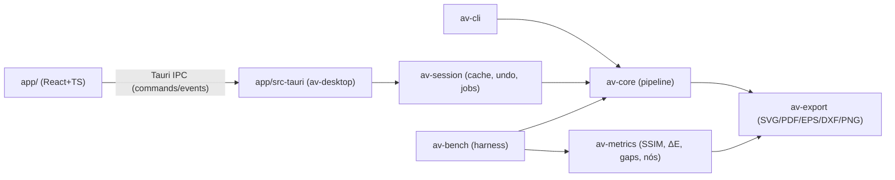

# 03 — Arquitetura

## 1. Visão geral


## 2. Estrutura do repositório [DEFINITIVO]
```
AntiVector/
├─ AGENTS.md
├─ Cargo.toml                 # workspace
├─ deny.toml  rust-toolchain.toml  .github/workflows/ci.yml
├─ docs/                      # fonte de verdade
├─ crates/
│  ├─ av-core/               # motor puro, sem I/O de arquivo, sem threads próprias além de rayon
│  │  └─ src/{lib.rs, params.rs, raster.rs, color/{oklab.rs,quantize.rs,antialias.rs},
│  │          preprocess.rs, segment/{label.rs,merge.rs}, boundary/{graph.rs,extract.rs},
│  │          fit/{polygon.rs,corners.rs,bezier.rs,optimize.rs}, assemble.rs, detect.rs,
│  │          pipeline.rs, progress.rs, error.rs}
│  ├─ av-export/             # writers: svg.rs, pdf.rs, eps.rs, dxf.rs, png.rs (via resvg)
│  ├─ av-metrics/            # ssim.rs, delta_e.rs, gaps.rs, stats.rs
│  ├─ av-session/            # Session, StageCache, EditOps, Undo, projeto .avproj
│  ├─ av-cli/                # binário `antivector`
│  └─ av-bench/              # binário harness + relatórios HTML
├─ app/                       # Tauri 2 + React + Vite + TS
│  ├─ src/{main.tsx, state/, components/, views/, ipc/, workers/}
│  └─ src-tauri/{Cargo.toml, src/main.rs, src/commands.rs}
└─ corpus/                    # imagens de teste (ver 07), manifest.json, baselines/
```

## 3. Responsabilidades
| Componente | Responsabilidade | Não pode |
|---|---|---|
| av-core | Raster RGBA8 → `VectorDoc`; estágios puros e determinísticos | Ler/escrever arquivos, depender de Tauri |
| av-export | `VectorDoc` → bytes de formato | Alterar geometria (exceto conversão de coordenadas) |
| av-metrics | Comparar raster original × raster renderizado do vetor | — |
| av-session | Cache de estágios, re‑execução parcial, edições, undo/redo, cancelamento | Lógica de vetorização |
| av-desktop | Comandos Tauri finos, serialização, eventos de progresso | Lógica de negócio |
| app (TS) | Render, interação, estado de UI | Processamento de imagem |

## 4. Contratos de dados (Rust, conceitual)
```rust
pub struct RgbaImage { pub w: u32, pub h: u32, pub px: Vec<[u8;4]> } // sRGB, alfa não pré‑multiplicado

pub enum Mode { Logo, Illustration, Photo, LineArt }
pub struct Params {               // serde, versão = 1
  pub mode: Mode,
  pub colors: ColorCount,          // Auto | Fixed(u16 2..=256)
  pub palette_lock: Vec<[u8;3]>,   // cores forçadas
  pub denoise: f32,                // 0..1
  pub min_region_area: u32,        // px
  pub antialias_resolve: bool,
  pub corner_threshold_deg: f32,   // ver 04 §8
  pub smoothness: f32,             // 0..1 → tolerância de ajuste
  pub fit_tolerance_px: f32,
  pub detail: f32,                 // 0..1 (mapeado a vários parâmetros, 04 §11)
  pub transparency_alpha_cut: u8,
  pub seed: u64,
}
pub struct Palette { pub colors: Vec<PaletteColor> } // id: u16 estável, rgb, oklab, locked
pub struct LabelMap { pub w: u32, pub h: u32, pub labels: Vec<u16> } // índice de paleta; u16::MAX = transparente
pub struct RegionMap { pub w:u32, pub h:u32, pub region_of: Vec<u32>, pub regions: Vec<Region> }
pub struct Region { pub id: u32, pub color: u16, pub area: u32, pub bbox: IRect }

pub struct BoundaryGraph {
  pub junctions: Vec<Junction>,           // ponto inteiro no grid de vértices (0..=w, 0..=h)
  pub edges: Vec<Edge>,                   // cada uma: start/end junction, left_region, right_region (Option = exterior), pts: Vec<IPoint>
  pub region_loops: Vec<Vec<Loop>>,       // por região: loop[0] exterior (CCW), demais furos (CW); Loop = Vec<(EdgeId, reversed: bool)>
}
pub struct FittedEdge { pub id: u32, pub segs: Vec<Seg> } // Seg = Line(P1) | Cubic(C1,C2,P1), início implícito
pub struct VectorDoc {
  pub width: f64, pub height: f64,
  pub palette: Palette,
  pub edges: Vec<FittedEdge>,
  pub shapes: Vec<Shape>,                  // Shape { region: u32, color: u16, loops: Vec<Vec<(u32,bool)>> }, ordenado por (área desc, id)
  pub stats: DocStats,                     // paths, nodes, colors, timings
}
```
Regras: todos os IDs são índices densos `0..n`, atribuídos em ordem de varredura raster (linha, coluna) ⇒ determinismo. Coordenadas do vetor em px da imagem, origem topo‑esquerda.

### API pública av-core
```rust
pub fn vectorize(img: &RgbaImage, p: &Params, ctl: &Control) -> Result<VectorDoc, CoreError>;
pub fn detect(img: &RgbaImage) -> Detection;  // modo sugerido, nº de cores, flags (has_alpha, is_jpeg_like, is_pixel_art)
// estágios individuais (usados por av-session para cache):
pub mod stages { preprocess, quantize, resolve_aa, label, merge_small, extract_boundaries, fit_edges, assemble }
pub struct Control { pub cancel: Arc<AtomicBool>, pub progress: Arc<dyn Fn(Stage, f32) + Send + Sync> }
```

### IPC Tauri (comandos)
| Comando | Entrada | Saída |
|---|---|---|
| `open_image` | path | `{session_id, w, h, detection, thumb_png_b64}` |
| `vectorize` | session_id, Params | job_id; eventos `progress{job_id,stage,frac}`, `done{job_id, doc_json_compact}`, `error{job_id, code, msg}` |
| `cancel` | job_id | () |
| `edit` | session_id, EditOp | doc delta |
| `undo`/`redo` | session_id | doc |
| `export` | session_id, format, options, path | () |
| `save_project`/`open_project` | path | session |
`doc_json_compact`: por shape `{color, d: "M…Z"}` string SVG path pré‑montada (o front não reconstrói geometria).

## 5. Cache e re‑execução (av-session)
Estágios encadeados com chave = hash(entrada do estágio + parâmetros relevantes). Mudança de `smoothness`/`corner_threshold` ⇒ re‑executa só `fit_edges`+`assemble`. Mudança de `colors` ⇒ a partir de `quantize`. Edições de paleta ⇒ re‑rotulagem dos pixels das cores afetadas + estágios seguintes. Tabela de dependência em 04 §11.

## 6. Concorrência
- Um job ativo por sessão; novo `vectorize` cancela o anterior (cancelamento cooperativo checado a cada ~64 linhas/arestas).
- Paralelismo: rayon em quantização (por blocos de linhas), ajuste (por aresta), métricas. Resultados coletados em `Vec` indexado por ID ⇒ determinístico.

## 7. Tratamento de erros
```rust
#[derive(thiserror::Error)] pub enum CoreError {
  ImageTooLarge{w,h,limit}, EmptyImage, Cancelled, InvalidParams(String), Internal(String) }
```
- av-core nunca dá panic em entrada do usuário; `Internal` indica bug (logar com contexto, teste de regressão obrigatório).
- Desktop mapeia para códigos `E_DECODE, E_TOO_LARGE, E_CANCELLED, E_PARAMS, E_EXPORT_IO, E_INTERNAL` com mensagem localizada (pt‑BR, en).
- Imagem totalmente transparente/uniforme ⇒ resultado válido (0 ou 1 shape), não erro.

## 8. Testabilidade
Cada estágio tem testes unitários com imagens sintéticas geradas no próprio teste; invariantes por proptest (04 §13); snapshots SVG com `insta` para corpus mínimo.

## 9. ADRs
| ADR | Decisão | Status |
|---|---|---|
| ADR‑001 | Motor em Rust, crate `av-core` puro | DEFINITIVO |
| ADR‑002 | Topologia por grafo de fronteiras compartilhadas; cada aresta ajustada uma vez | DEFINITIVO |
| ADR‑003 | Desktop Tauri 2 + React/TS; av-core deve compilar para `wasm32-unknown-unknown` (checado no CI) para futura versão web | DEFINITIVO |
| ADR‑004 | Espaço de cor OKLab para quantização e distâncias; ΔE00 só para métricas | DEFINITIVO |
| ADR‑005 | Sem GPL no produto; vtracer só como baseline em av-bench | DEFINITIVO |
| ADR‑006 | Exportação SVG padrão em modo "empilhado sem sobreposição" (shapes com furos exatos, fill-rule evenodd); opção "empilhado com sobreposição" | DEFINITIVO |
| ADR‑007 | Algoritmo de quantização inicial: k‑means++ em OKLab com inicialização determinística (seed) sobre histograma 5‑5‑5 ponderado | DEFINITIVO (experimento F3 registrado abaixo) |
| ADR‑008 | IA fora do caminho crítico v1 | DEFINITIVO |
| ADR-009 | Recuperação multiescala de cantos recortados, com raio configurável e junções fixas | HIPÓTESE calibrada em F4; configuração conservadora passou ambos os gates locais |

Novos ADRs: acrescentar linha + seção abaixo com contexto, decisão, evidência, consequências.

### ADR-007 — Fixação do quantizador inicial (2026-10-28)

Contexto: comparar k-means++ (até 30 iterações), median-cut ponderado em OKLab
com 3 iterações de refino e Wu com momentos cumulativos 3D e cortes por redução
de variância perceptual. Alternativas implementadas independentemente, sem código GPL.

Decisão: manter k-means++ como padrão inicial. As alternativas permanecem opt-in
em `Params.experimental.quantizer`, para ampliar a comparação no corpus futuro.

Evidência: 29 imagens geradas (20 synthetic, 5 logos geométricos originais,
4 edge); execução release Windows x86_64, mesmos parâmetros/seed/critério Auto.
SSIM médio: k-means 0,9898374755251024, median-cut 0,9894554629786206,
Wu 0,9898374755251024. ΔE00 médio: 1,0691885715404488 / 1,060078518640222 /
1,0691885715404488, respectivamente. Zero frestas nas três variantes.
Median-cut perde aproximadamente 0,015321 de SSIM em triangles, ultrapassando
o limite individual de 0,005; melhora concentric, mas não vence o gate por imagem.
Wu empata em todas as métricas de fidelidade/complexidade neste corpus.
Após 5 repetições por imagem e variante, mediana entre imagens das medianas de
quantização: k-means 1,5181 ms; median-cut 1,3959 ms; Wu 2,0147 ms.
Wu é aproximadamente 32,7% mais lento nessa medida; a vantagem de tempo do
median-cut não compensa a regressão de fidelidade definida no plano.

Artefatos versionados: `corpus/baselines/experiments/f3-{kmeans,median,wu}.json`,
`f3-perf-{kmeans,median,wu}.json` e diretórios `compare-*` com HTML/previews.
Consequências: nenhuma dependência adicional de quantização no produto;
reduções sequenciais e atribuição paralela indexada preservam determinismo.
Limite da evidência: somente corpus inicial gerado, sem alegação de superioridade
geral em fotografias ou material externo. Alterar o padrão exige novo ADR.

### ADR-009 — Experimento de recuperação de cantos (2026-10-28)

Contexto: na configuração experimental de F4, pontas agudas rasterizadas com AA
aparecem como pequenos segmentos entre duas retas longas. Somente ajustar vértices
na caixa de raio 0,5px não recupera essas pontas: no corpus inicial, Hausdorff médio
sintético medido de 0,52078811601536px, acima da meta 0,5px. O experimento usa as
retas de suporte por mínimos quadrados, sem consultar o GT durante o ajuste.

Experimento: `experimental.curve_fit=true` e
`experimental.corner_recovery_radius=1.5`, mantendo todos os extremos de junções
exatamente fixos. A caixa inicial dos demais vértices permanece de raio 0,5px.
A exceção de raio ampliado se aplica somente à recuperação multiescala sustentada
por duas retas longas e um segmento curto; não muda topologia nem duplica arestas.
Na primeira revisão, raio padrão 0,5px e curvas desligadas foram mantidos enquanto
o experimento ainda falhava no gate de regressão.

Evidência release: `corpus/baselines/experiments/f4-radius-15.json` e
`f4-curves-params.json`. Nas 20 synthetic, Hausdorff médio 0,391730584207358px,
corner recall médio 0,991666666666667, nós ≤ vtracer com SSIM ≥ vtracer em 18/20
(90%); 0 gaps nas 29 imagens. O teste do círculo r50 mediu seis segmentos e
Hausdorff 0,36038093px; quadrado 30° com quatro Lines; estrela com dez cantos.

Revisão conservadora: preservar contornos binários, trechos retos exatos e laços
fechados de componentes com interfaces opacas coloridas evita as regressões AA
sem mudar ADR-006. Remover âncoras collineares na montagem não altera geometria.
`f4-conservative-final.json`: Hausdorff médio 0,490407562703638px, corner recall
0,976666666666667, 18/20 synthetic (90%) com nós ≤ vtracer e SSIM ≥ vtracer,
0 gaps nas 29 imagens. Essa configuração também passou o gate geral contra
`corpus/baselines/metrics.json`, sem mudar baseline nem relaxar limites.

Após 32 testes e os cinco checks locais aprovados, a configuração conservadora
é adotada: curvas ligadas e raio de recuperação 1,5px; permanecem disponíveis
o modo poligonal de referência e raio 0,5px para comparação. As junções continuam
fixas e a caixa de ajuste de vértices comuns continua com raio 0,5px. A revisão
automática havia rejeitado a promoção antes dessa validação; a nova tentativa
usa a alternativa que eliminou as regressões. Nenhuma decisão DEFINITIVO mudou.
Limite: resultado calibrado no corpus inicial; F5 deve resolver AA multicor para
reduzir também os nós dos componentes preservados conservadoramente.
