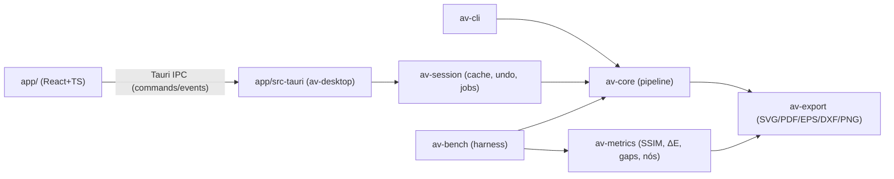

# 03 — Arquitetura

## 1. Visão geral


## 2. Estrutura do repositório [DEFINITIVO]
```
AntiVector/
├─ AGENTS.md
├─ Cargo.toml                 # workspace
├─ deny.toml  rust-toolchain.toml  .github/workflows/ci.yml
├─ docs/                      # fonte de verdade
├─ crates/
│  ├─ av-core/               # motor puro, sem I/O de arquivo, sem threads próprias além de rayon
│  │  └─ src/{lib.rs, params.rs, raster.rs, color/{oklab.rs,quantize.rs,antialias.rs},
│  │          preprocess.rs, segment/{label.rs,merge.rs}, boundary/{graph.rs,extract.rs},
│  │          fit/{polygon.rs,corners.rs,bezier.rs,optimize.rs}, assemble.rs, detect.rs,
│  │          pipeline.rs, progress.rs, error.rs}
│  ├─ av-export/             # writers: svg.rs, pdf.rs, eps.rs, dxf.rs, png.rs (via resvg)
│  ├─ av-metrics/            # ssim.rs, delta_e.rs, gaps.rs, stats.rs
│  ├─ av-session/            # Session, StageCache, EditOps, Undo, projeto .avproj
│  ├─ av-cli/                # binário `antivector`
│  └─ av-bench/              # binário harness + relatórios HTML
├─ app/                       # Tauri 2 + React + Vite + TS
│  ├─ src/{main.tsx, state/, components/, views/, ipc/, workers/}
│  └─ src-tauri/{Cargo.toml, src/main.rs, src/commands.rs}
└─ corpus/                    # imagens de teste (ver 07), manifest.json, baselines/
```

## 3. Responsabilidades
| Componente | Responsabilidade | Não pode |
|---|---|---|
| av-core | Raster RGBA8 → `VectorDoc`; estágios puros e determinísticos | Ler/escrever arquivos, depender de Tauri |
| av-export | `VectorDoc` → bytes de formato | Alterar geometria (exceto conversão de coordenadas) |
| av-metrics | Comparar raster original × raster renderizado do vetor | — |
| av-session | Cache de estágios, re‑execução parcial, edições, undo/redo, cancelamento | Lógica de vetorização |
| av-desktop | Comandos Tauri finos, serialização, eventos de progresso | Lógica de negócio |
| app (TS) | Render, interação, estado de UI | Processamento de imagem |

## 4. Contratos de dados (Rust, conceitual)
```rust
pub struct RgbaImage { pub w: u32, pub h: u32, pub px: Vec<[u8;4]> } // sRGB, alfa não pré‑multiplicado

pub enum Mode { Logo, Illustration, Photo, LineArt }
pub struct Params {               // serde, versão = 1
  pub mode: Mode,
  pub colors: ColorCount,          // Auto | Fixed(u16 2..=256)
  pub palette_lock: Vec<[u8;3]>,   // cores forçadas
  pub denoise: f32,                // 0..1
  pub min_region_area: u32,        // px
  pub antialias_resolve: bool,
  pub corner_threshold_deg: f32,   // ver 04 §8
  pub smoothness: f32,             // 0..1 → tolerância de ajuste
  pub fit_tolerance_px: f32,
  pub detail: f32,                 // 0..1 (mapeado a vários parâmetros, 04 §11)
  pub transparency_alpha_cut: u8,
  pub seed: u64,
}
pub struct Palette { pub colors: Vec<PaletteColor> } // id: u16 estável, rgb, oklab, locked
pub struct LabelMap { pub w: u32, pub h: u32, pub labels: Vec<u16> } // índice de paleta; u16::MAX = transparente
pub struct RegionMap { pub w:u32, pub h:u32, pub region_of: Vec<u32>, pub regions: Vec<Region> }
pub struct Region { pub id: u32, pub color: u16, pub area: u32, pub bbox: IRect }

pub struct BoundaryGraph {
  pub junctions: Vec<Junction>,           // ponto inteiro no grid de vértices (0..=w, 0..=h)
  pub edges: Vec<Edge>,                   // cada uma: start/end junction, left_region, right_region (Option = exterior), pts: Vec<IPoint>
  pub region_loops: Vec<Vec<Loop>>,       // por região: loop[0] exterior (CCW), demais furos (CW); Loop = Vec<(EdgeId, reversed: bool)>
}
pub struct FittedEdge { pub id: u32, pub segs: Vec<Seg> } // Seg = Line(P1) | Cubic(C1,C2,P1), início implícito
pub struct VectorDoc {
  pub width: f64, pub height: f64,
  pub palette: Palette,
  pub edges: Vec<FittedEdge>,
  pub shapes: Vec<Shape>,                  // Shape { region: u32, color: u16, loops: Vec<Vec<(u32,bool)>> }, ordenado por (área desc, id)
  pub stats: DocStats,                     // paths, nodes, colors, timings
}
```
Regras: todos os IDs são índices densos `0..n`, atribuídos em ordem de varredura raster (linha, coluna) ⇒ determinismo. Coordenadas do vetor em px da imagem, origem topo‑esquerda.

### API pública av-core
```rust
pub fn vectorize(img: &RgbaImage, p: &Params, ctl: &Control) -> Result<VectorDoc, CoreError>;
pub fn detect(img: &RgbaImage) -> Detection;  // modo sugerido, nº de cores, flags (has_alpha, is_jpeg_like, is_pixel_art)
// estágios individuais (usados por av-session para cache):
pub mod stages { preprocess, quantize, resolve_aa, label, merge_small, extract_boundaries, fit_edges, assemble }
pub struct Control { pub cancel: Arc<AtomicBool>, pub progress: Arc<dyn Fn(Stage, f32) + Send + Sync> }
```

### API pública av-export (F6)
`export(&VectorDoc, Format, &SvgOptions) -> Result<Vec<u8>, CoreError>` não faz
I/O nem modifica o documento. `statistics` conta a representação emitida, após
omissão de furos/agrupamento; DXF conta arestas únicas e vértices aproximados.

- SVG 1.1: `precision=0..8` (padrão 2), viewBox no tamanho de entrada; agrupamento
  por RGB mescla subpaths em um path. Agrupamento exige recorte exato, pois
  reordenar cores com sobreposição alteraria a ordem de pintura de ADR-010.
- PDF (`pdf-writer`) e EPS Level 2/DSC: paths vetoriais, preenchimento even-odd;
  96px equivalem a 72pt, Y convertido para cima. Nenhum raster é embutido.
- DXF: R12/AC1009, POLYLINE+VERTEX+SEQEND, sem LWPOLYLINE/SPLINE; cada fronteira
  compartilhada usada é emitida uma vez. Unidade = pixel, Y para cima. Cúbicas
  subdivididas por de Casteljau até limite conservador ≤0,1px, preservando extremos.
- PNG: resvg, resolução original, RGBA com transparência; mesmos paths/opções
  usados no SVG. Recursos externos e fontes não fazem parte da saída.

### IPC Tauri (comandos)
| Comando | Entrada | Saída |
|---|---|---|
| `open_image` | path, reduce_to opcional | `{session_id, name, w, h, detection, params, thumb_png_b64, original_png_b64}` |
| `open_image_bytes` / `open_clipboard` | nome+bytes / sem entrada; reduce_to opcional | mesma sessão decodificada de open_image |
| `vectorize` | session_id, Params, request_id | job_id; eventos progress/preview/done/error com session_id, request_id e job_id; progress inclui stage/frac, preview/done incluem doc compacto, error inclui code/msg |
| `cancel` / `close_session` | session_id | cancela o job corrente / cancela e libera a sessão |
| `edit` | session_id, EditOp, request_id | job_id; mesmo protocolo cancellável de eventos, done inclui doc+params+history |
| `undo`/`redo` / `current_document` | session_id | `{doc,params,history{undo_depth,redo_depth}}` |
| `export` | session_id, format, options, path | () |
| `save_project` | session_id, path, nome da imagem | gravação atômica .avproj |
| `open_project` / `open_project_bytes` | path / bytes | sessão com original e estado restaurado, sem re-vetorização automática que descarte edições |
| `estimate_fidelity` | session_id | SSIM estimado, dimensões da amostra e estimated=true |
`doc_json_compact`: por shape `{color, d: "M…Z"}` string SVG path pré‑montada (o front não reconstrói geometria).

Contrato concretizado em F7: cancelamento usa a sessão para também cobrir a
janela em que vectorize ainda não retornou job_id ao frontend. request_id é o
nonce do frontend; session_id+request_id filtram eventos atrasados, inclusive
ao abrir outra imagem. O job_id Rust continua monotônico por sessão. A prévia
nunca substitui o documento completo exportável. Paths também incluem region
e âncoras para inspeção, sem recalcular geometria no JavaScript.

F8: transporte desktop serializa seed u64 como string decimal e aceita string
ou número no IPC. Arquivos Params/projetos e a CLI mantêm u64 JSON numérico.
Evita arredondamento JavaScript acima de2^53; teste cobre u64::MAX e overflow.
Medição de SSIM na UI é opcional e calculada no worker em amostra≤65.536pixels,
composta sobre branco e identificada como estimativa; não substitui o harness.

## 5. Cache e re‑execução (av-session)
Estágios encadeados com chave = hash(entrada do estágio + parâmetros relevantes). Mudança de `smoothness`/`corner_threshold` ⇒ re‑executa só `fit_edges`+`assemble`. Mudança de `colors` ⇒ a partir de `quantize`. Edições de paleta ⇒ re‑rotulagem dos pixels das cores afetadas + estágios seguintes. Tabela de dependência em 04 §11.

F7 implementa a chave por igualdade explícita dos parâmetros relevantes e
fonte imutável, evitando colisões de hash. Produtos usam Arc; somente estágios
concluídos são publicados no cache. A chave e invalidações são atualizadas
antes da execução, para uma interrupção não reutilizar produtos de outra chave.

### Edição, histórico e projeto (F8)

EditOps são transacionais sobre LabelMap/RegionMap: MergePalette, RecolorPalette,
DeletePalette, LockColor, MergeRegion e RemoveRegion. Mudanças de cor iguais
coalescem rótulos; remoção torna transparente; MergeRegion exige vizinhança,
com destino automático por distância OKLab/comprimento de borda e desempate ID.
Depois da re-rotulagem, extração/ajuste usam um único grafo compartilhado.

Comandos persistidos incluem Selection com ponto em unidades da imagem original
e RGB de referência. São resolvidos contra os IDs densos atuais no replay,
evitando reutilizar um ID de outra região após alterar parâmetros. Seleções de
cor usam primeiro o ponto e depois a cor perceptualmente mais próxima.
Operações de região também persistem sua máscara em runs `[início,tamanho]`
no grid preparado, com escala da imagem original. Replay pinta somente essa
área, nunca a região maior resultante de uma mescla posterior de parâmetros.
MergeRegion registra a cor/destino resolvido na criação; a máscara se conserva
e a seleção de destino acompanha a paleta atual. Trocas de escala usam centros
de pixel para reamostrar a máscara. Dimensões, runs e âncoras são validados.
Novos comandos inválidos são rejeitados antes de entrar no histórico.

Editor prepara rascunhos; somente o job ativo confirma documento e histórico.
Até128 revisões anteriores guardam parâmetros, comandos e Arc do documento
montado, compartilhando a fonte e o cache raster. Undo/redo restaura o SVG exato
e parâmetros, inclusive locks. Uma nova edição elimina redo. Os contadores
StageCache medem a base; replay de edições é trabalho derivado separado.
Após haver edições, mudanças de parâmetros conservam o documento anterior até
o completo, evitando exibir uma prévia sem as edições aplicadas.

Formato `.avproj` v1: ZIP Stored sem ZIP64/comentário, quatro membros fixos:
manifest.json (`format=antivector`, version=1, width/height e nome da imagem),
original.png (pixels RGBA8 originais após decodificação F1, PNG sem perda),
params.json e edits.json (RecordedEdit em ordem). Metadados do contêiner de
entrada não integram o modelo raster do projeto. Versões futuras exigem migração.
Não há extração de caminhos para disco. Limites de diretório/membros são
verificados antes de alocação/decodificação; máximo64MP e10.000 comandos.
Gravação usa arquivo temporário ao lado do destino, sync e persist atômico;
falhas de validação/gravação não substituem o projeto anterior.

## 6. Concorrência
- Um job ativo por sessão; novo `vectorize` cancela o anterior (cancelamento cooperativo checado a cada ~64 linhas/arestas).
- Paralelismo: rayon em quantização (por blocos de linhas), ajuste (por aresta), métricas. Resultados coletados em `Vec` indexado por ID ⇒ determinístico.

## 7. Tratamento de erros
```rust
#[derive(thiserror::Error)] pub enum CoreError {
  ImageTooLarge{w,h,limit}, EmptyImage, Cancelled, InvalidParams(String), Internal(String) }
```
- av-core nunca dá panic em entrada do usuário; `Internal` indica bug (logar com contexto, teste de regressão obrigatório).
- Desktop mapeia para códigos `E_DECODE, E_TOO_LARGE, E_CANCELLED, E_PARAMS, E_EXPORT_IO, E_INTERNAL` com mensagem localizada (pt‑BR, en).
- Imagem totalmente transparente/uniforme ⇒ resultado válido (0 ou 1 shape), não erro.

## 8. Testabilidade
Cada estágio tem testes unitários com imagens sintéticas geradas no próprio teste; invariantes por proptest (04 §13); snapshots SVG com `insta` para corpus mínimo.

## 9. ADRs
| ADR | Decisão | Status |
|---|---|---|
| ADR‑001 | Motor em Rust, crate `av-core` puro | DEFINITIVO |
| ADR‑002 | Topologia por grafo de fronteiras compartilhadas; cada aresta ajustada uma vez | DEFINITIVO |
| ADR‑003 | Desktop Tauri 2 + React/TS; av-core deve compilar para `wasm32-unknown-unknown` (checado no CI) para futura versão web | DEFINITIVO |
| ADR‑004 | Espaço de cor OKLab para quantização e distâncias; ΔE00 só para métricas | DEFINITIVO |
| ADR‑005 | Sem GPL no produto; vtracer só como baseline em av-bench | DEFINITIVO |
| ADR‑006 | Exportação SVG padrão em modo "empilhado sem sobreposição" (shapes com furos exatos, fill-rule evenodd); opção "empilhado com sobreposição" | DEFINITIVO |
| ADR‑007 | Algoritmo de quantização inicial: k‑means++ em OKLab com inicialização determinística (seed) sobre histograma 5‑5‑5 ponderado | DEFINITIVO (experimento F3 registrado abaixo) |
| ADR‑008 | IA fora do caminho crítico v1 | DEFINITIVO |
| ADR-009 | Recuperação multiescala de cantos recortados, com raio configurável e junções fixas | HIPÓTESE calibrada em F4; configuração conservadora passou ambos os gates locais |
| ADR-010 | Sobreposição opaca segura como padrão SVG; geometria interna preservada | DEFINITIVO, substitui o padrão de ADR-006 |
| ADR-011 | Calibração de AA, upscale, denoise e pixel art no corpus F5 | Hipóteses calibradas, alternativas por flags |
| ADR-012 | Exceção de licença restrita a target-lexicon0.12.16, dependência de build Tauri/Linux | DEFINITIVO, exceção pontual à allowlist F0 |
| ADR-013 | Exceções BSL-1.0 nas duas dependências da área de transferência Windows | DEFINITIVO, versões auditadas |
| ADR-014 | Exceção NCSA restrita ao libfuzzer-sys0.4.13 no workspace de fuzz | DEFINITIVO, ferramenta de teste fora do produto |

Novos ADRs: acrescentar linha + seção abaixo com contexto, decisão, evidência, consequências.

### ADR-007 — Fixação do quantizador inicial (2026-10-28)

Contexto: comparar k-means++ (até 30 iterações), median-cut ponderado em OKLab
com 3 iterações de refino e Wu com momentos cumulativos 3D e cortes por redução
de variância perceptual. Alternativas implementadas independentemente, sem código GPL.

Decisão: manter k-means++ como padrão inicial. As alternativas permanecem opt-in
em `Params.experimental.quantizer`, para ampliar a comparação no corpus futuro.

Evidência: 29 imagens geradas (20 synthetic, 5 logos geométricos originais,
4 edge); execução release Windows x86_64, mesmos parâmetros/seed/critério Auto.
SSIM médio: k-means 0,9898374755251024, median-cut 0,9894554629786206,
Wu 0,9898374755251024. ΔE00 médio: 1,0691885715404488 / 1,060078518640222 /
1,0691885715404488, respectivamente. Zero frestas nas três variantes.
Median-cut perde aproximadamente 0,015321 de SSIM em triangles, ultrapassando
o limite individual de 0,005; melhora concentric, mas não vence o gate por imagem.
Wu empata em todas as métricas de fidelidade/complexidade neste corpus.
Após 5 repetições por imagem e variante, mediana entre imagens das medianas de
quantização: k-means 1,5181 ms; median-cut 1,3959 ms; Wu 2,0147 ms.
Wu é aproximadamente 32,7% mais lento nessa medida; a vantagem de tempo do
median-cut não compensa a regressão de fidelidade definida no plano.

Artefatos versionados: `corpus/baselines/experiments/f3-{kmeans,median,wu}.json`,
`f3-perf-{kmeans,median,wu}.json` e diretórios `compare-*` com HTML/previews.
Consequências: nenhuma dependência adicional de quantização no produto;
reduções sequenciais e atribuição paralela indexada preservam determinismo.
Limite da evidência: somente corpus inicial gerado, sem alegação de superioridade
geral em fotografias ou material externo. Alterar o padrão exige novo ADR.

### ADR-009 — Experimento de recuperação de cantos (2026-10-28)

Contexto: na configuração experimental de F4, pontas agudas rasterizadas com AA
aparecem como pequenos segmentos entre duas retas longas. Somente ajustar vértices
na caixa de raio 0,5px não recupera essas pontas: no corpus inicial, Hausdorff médio
sintético medido de 0,52078811601536px, acima da meta 0,5px. O experimento usa as
retas de suporte por mínimos quadrados, sem consultar o GT durante o ajuste.

Experimento: `experimental.curve_fit=true` e
`experimental.corner_recovery_radius=1.5`, mantendo todos os extremos de junções
exatamente fixos. A caixa inicial dos demais vértices permanece de raio 0,5px.
A exceção de raio ampliado se aplica somente à recuperação multiescala sustentada
por duas retas longas e um segmento curto; não muda topologia nem duplica arestas.
Na primeira revisão, raio padrão 0,5px e curvas desligadas foram mantidos enquanto
o experimento ainda falhava no gate de regressão.

Evidência release: `corpus/baselines/experiments/f4-radius-15.json` e
`f4-curves-params.json`. Nas 20 synthetic, Hausdorff médio 0,391730584207358px,
corner recall médio 0,991666666666667, nós ≤ vtracer com SSIM ≥ vtracer em 18/20
(90%); 0 gaps nas 29 imagens. O teste do círculo r50 mediu seis segmentos e
Hausdorff 0,36038093px; quadrado 30° com quatro Lines; estrela com dez cantos.

Revisão conservadora: preservar contornos binários, trechos retos exatos e laços
fechados de componentes com interfaces opacas coloridas evita as regressões AA
sem mudar ADR-006. Remover âncoras collineares na montagem não altera geometria.
`f4-conservative-final.json`: Hausdorff médio 0,490407562703638px, corner recall
0,976666666666667, 18/20 synthetic (90%) com nós ≤ vtracer e SSIM ≥ vtracer,
0 gaps nas 29 imagens. Essa configuração também passou o gate geral contra
`corpus/baselines/metrics.json`, sem mudar baseline nem relaxar limites.

Após 32 testes e os cinco checks locais aprovados, a configuração conservadora
é adotada: curvas ligadas e raio de recuperação 1,5px; permanecem disponíveis
o modo poligonal de referência e raio 0,5px para comparação. As junções continuam
fixas e a caixa de ajuste de vértices comuns continua com raio 0,5px. A revisão
automática havia rejeitado a promoção antes dessa validação; a nova tentativa
usa a alternativa que eliminou as regressões. Nenhuma decisão DEFINITIVO mudou.
Limite: resultado calibrado no corpus inicial; F5 deve resolver AA multicor para
reduzir também os nós dos componentes preservados conservadoramente.

### ADR-010 — Sobreposição opaca segura e qualidade F5 (2026-10-28)

Substitui o padrão de exportação de ADR-006. Motivo: compartilhar a mesma curva
evita frestas geométricas, mas o compositor AA pode deixar uma linha de fundo
entre dois paths com furos coincidentes. Mantém-se a geometria canônica única;
somente o escritor SVG omite furos cobertos por shapes opacos posteriores.
Todos os descendentes devem existir e ser desenhados depois: transparência ou
descendente anterior conserva o furo. `--stacking exact` continua disponível.

Evidência: `f5-exact.json` × `f5-candidate.json`, 34 imagens, zero gaps nos dois
modos. Concentric: SSIM 0,968855 → 0,986571; logos: SSIM melhora em 5/5 e
ΔE00 diminui em 5/5. Dois testes de composição conferem igualdade pixel a pixel
sem AA, incluindo transparência e descendente maior desenhado antes. O gate
geral contra a baseline F4 passou nas 29 imagens sem relaxar limites. O gate
geométrico permaneceu verde: Hausdorff médio 0,486993246306px, recall
0,988095238095, 16/20 synthetic com nós/SSIM pelo menos equivalentes ao vtracer.

Decisão [DEFINITIVO]: SVG usa sobreposição opaca segura por padrão; paths com
furos exatos são opção explícita. Impacto: menos subpaths/nós emitidos, mesma
topologia e mesmos dados de sessão; exportações futuras devem escolher e testar
sua política de composição. A avaliação visual humana permanece pendente;
esta decisão usa medidas do renderizador e testes, não votos inventados.

### ADR-011 — Calibração multicor e experimentos F5 (2026-10-28)

Após o A/B e cinco checks locais aprovados, adota-se `quality_v5` para novos
parâmetros/presets. A flag falsa preserva o pipeline histórico. São ativados:
limpeza alfa em luz linear, bicúbico 2× para entradas pequenas elegíveis,
denoise, resolução AA em dois passes, proteção de detalhe fino e snap ≥60%.
Auto inclui cores minoritárias estáveis do detector; pixel art retém todas as
cores exatas (até64), incluindo acentos menores que 0,5% da área. Paletas são
compactadas após AA e merge; cores travadas nunca são descartadas.

Upscale permanece hipótese calibrada: fonte <256px, sem pixel art e com frame
uniforme. Um frame multicor mantém amostragem original para não criar fragmentos
nas junções fixas do quadro (junction_y passou de25 para13 nós). Cadeias maiores
que a janela do polígono (200 pontos) são ajustadas em unidades da fonte;
detalhes menores usam a resolução ampliada. Isso reduziu circle_r50 de72 para9
nós emitidos, sem trocar as junções. O gate geral F4 passou com essa política.
Sem upscale, somente3/5 logos venceram nós+fidelidade; com a política calibrada,
5/5 venceram (19/19/26/26/23 nós; SSIM mínimo0,998686524; ΔE00 máximo0,030221964).
O vtracer recebe exatamente a mesma segmentação pós-merge, paleta e escala;
ambos em modo stacked, precisão8bits, speckle0, layer_difference0.

Experimento denoise: bilateral/mean-shift/guided mediram, respectivamente,
SSIM médio0,996327371/0,996393295/0,995856898 e1229/1253/1283 nós nas34 imagens.
Guiado piora fidelidade; mean-shift acrescenta24 nós por ganho SSIM0,000065924.
Mantém-se bilateral; alternativas permanecem experimentais. As médias das
medianas de preprocess de5 repetições foram1,647788/1,725041/1,631018ms.
Não são metas RNF nem prova de superioridade em fotos; corpus completo é F9.

Experimento pixel art (cinco sprites originais, grid4×): PreserveGrid teve SSIM1,
ΔE00=0 em5/5; ScaleCorners alterou flower (SSIM0,999979, ΔE00=0,001304) e aumentou
seus nós de70 para72. Mantém-se PreserveGrid. O arquivo antigo `f5-pixel-scale`
foi descartado: uma atribuição PowerShell falhou e não ativou a estratégia;
somente `f5-pixel-final.json` contém o experimento válido.

Limites: critérios de F5 são avaliados no corpus atual (20 synthetic,5 logos,
4edge,5pixelart). Não há amostras lineart/illustration/photo suficientes para
alegar aceite global de v1. Avaliação cega gerada deve ser preenchida pelo usuário.

### ADR-012 — Exceção pontual de build para Tauri/Linux (2026-10-28)

Motivo: a allowlist F0 não inclui a expressão SPDX `Apache-2.0 WITH
LLVM-exception`. `cargo deny check licenses` rejeitou target-lexicon0.12.16,
dependência de cfg-expr0.15.8 → system-deps6.2.2, usada pelos build scripts
GTK/WebKit de Tauri2 no Linux. Remover esse suporte contrariaria ADR-003.

Evidência: Cargo.lock e o grafo impresso pelo cargo-deny identificaram essa única
rejeição. O arquivo LICENSE do crate contém Apache2 e a exceção LLVM; ela concede
dispensas adicionais para partes incorporadas na compilação, não impõe GPL ao
produto. Conferidos o texto [oficial LLVM](https://llvm.org/LICENSE.txt) e a
[documentação de exceções por pacote](https://embarkstudios.github.io/cargo-deny/checks/licenses/cfg.html#the-exceptions-field).

Decisão [DEFINITIVO]: permitir essa expressão somente para
`target-lexicon =0.12.16` em `licenses.exceptions`, mantendo a allowlist global
inalterada. Não desabilitar a análise de build-dependencies. Nenhuma dependência
GPL/AGPL é autorizada por esta decisão. Versões/pacotes adicionais exigem nova
revisão explícita; a pinagem vem do lockfile, sem fork de código ou licença.

Impacto: os build scripts de descoberta de bibliotecas nativas passam na
auditoria; nenhuma geometria, métrica, contrato de dados ou rede do produto muda.
Tauri continua usando frameworks nativos dos sistemas operacionais. O aviso de
licença não pode ser suprimido nem substituído por um resultado inventado.

### ADR-013 — Área de transferência Windows e BSL-1.0 (2026-10-29)

Motivo: o requisito de colar imagem usa o plugin oficial Tauri clipboard-manager,
que depende de arboard3.7.0 → clipboard-win5.4.3 → error-code3.4.0 no Windows.
Cargo-deny rejeitou os dois últimos por BSL-1.0, ausente na allowlist F0.

Evidência: grafo e versões medidos em Cargo.lock/cargo-deny; manifesto dos dois
crates declara BSL-1.0. LICENSE de error-code e o
[texto oficial Boost](https://www.boost.org/LICENSE_1_0.txt) conferidos: licença
permissiva, permite derivados e distribuição executável, sem obrigação de
abrir o produto. Distribuições de fonte devem conservar avisos e licença.

Decisão [DEFINITIVO]: exceções restritas a clipboard-win=5.4.3 e
error-code=3.4.0 em deny.toml; allowlist global permanece igual. Não remover a
auditoria ou autorizar GPL/AGPL. Atualizações exigem nova revisão das exceções.

Impacto: mantém a integração nativa exigida, sem implementar chamadas Win32
próprias; nenhuma mudança no motor ou em dados transmitidos. F9 deve incluir
avisos de terceiros da distribuição, inclusive esses textos quando aplicável.

### ADR-014 — Licença da ferramenta de fuzz (2026-10-29)

Motivo: F9 exige cargo-fuzz local. A auditoria separada rejeitou
libfuzzer-sys0.4.13 pela expressão `(MIT OR Apache-2.0) AND NCSA` do manifesto.
Esse pacote só pertence a `fuzz/`, workspace separado, e não integra desktop/CLI.

Evidência: manifesto publicado e log real do cargo-deny; texto
[NCSA no catálogo SPDX](https://spdx.org/licenses/NCSA.html) permite uso e
redistribuição com avisos e cláusula de não endosso. Não impõe copyleft.
Os cabeçalhos C++ atuais também apontam para
[Apache2 com exceções LLVM](https://llvm.org/LICENSE.txt); não reescrevemos a
declaração do pacote para contornar a auditoria.

Decisão [DEFINITIVO]: `fuzz/deny.toml` permite NCSA apenas para
libfuzzer-sys=0.4.13. A allowlist e as exceções do produto em `deny.toml`
continuam inalteradas. Auditar o workspace de fuzz explicitamente com essa
configuração; não distribuir o runtime de fuzz nos instaladores.

Impacto: viabiliza o teste exigido com AddressSanitizer sem introduzir GPL/AGPL
ou nova dependência de produção. Versões futuras requerem nova revisão.
