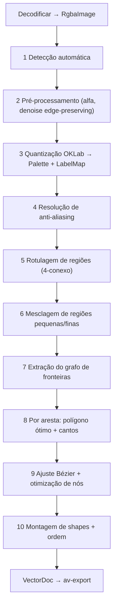

# 04 — Motor de Vetorização (av-core)

## 1. Detecção automática (`detect.rs`)
Calcular sobre imagem reduzida para ≤ 512 px no maior lado (box filter):
- `has_alpha`: algum α < 250.
- `unique_colors` (exato, até 4096; acima disso = "muitas").
- `edge_sharpness`: fração de pixels de borda (gradiente Sobel > 40) cujo vizinho na direção do gradiente difere < 8 níveis do extremo ⇒ alta = sem AA.
- `jpeg_like`: energia residual em fronteiras de bloco 8×8 / energia residual média > 1,3; na calibração F3, medir só diferenças ≤20 níveis e exigir diferenças entre 0,5 e 20 em >10% do nº de pixels (evita confundir bordas geométricas alinhadas ao grid com blocos JPEG).
- `pixel_art`: lado ≤256 e repetição inteira de fator 2..8 em ≥95% dos pixels **e dos pixels de borda**; ou unique_colors≤2 e edge_sharpness>0,9; ou unique_colors≤64, edge_sharpness>0,9 e lado≤64. A calibração F4 restringiu o último caso e passou a conferir bordas, pois fundos planos faziam imagens AA parecerem repetidas. Contornos binários permanecem preservados para não perder SSIM no raster de referência.
Regras [HIPÓTESE, calibradas no corpus inicial F3; ampliar validação com corpus completo]:
- unique ≤ 2 (ou luminância bimodal com 95% em 2 picos) ⇒ LineArt.
- histograma OKLab dominado (≥ 90% em ≤ 16 clusters de raio 0,04) ⇒ Logo, cores = nº desses clusters, incluindo também clusters minoritários com ≥0,5% da área que não sejam misturas AA de duas cores mais frequentes (projeção t=0,1..0,9 e distância <0,03). Esse piso preservou os acentos dos cinco logos gerados em F3.
- ≥ 90% em ≤ 64 clusters ⇒ Illustration.
- senão ⇒ Photo, cores = 24.
Nº de cores Auto: menor k tal que erro de quantização médio (OKLab) ≤ 0,02 (Logo), 0,03 (Illustration), 0,05 (Photo), limitado a 2..=64 (Photo até 128).

Calibração F3: `corpus/baselines/experiments/detection-calibration.json` registra
antes/depois. Contagem sugerida correta em 22/29 → 28/29 (comparação com
max(2, expected_colors), conforme faixa contratual); JPEG q60 passou de GT para
GT+1, ainda na tolerância da fase F5. O gate residual removeu os falsos positivos
JPEG das imagens geradas sem compressão e manteve o JPEG q60 detectado. Para
luminância bimodal, exigir também ≥95% de pixels neutros (diferença entre canais
≤8), evitando classificar logos coloridos com cor minoritária como P&B.
Esses resultados não representam validação em logos externos ou fotografias.

## 2. Pré‑processamento (`preprocess.rs`)
1. **Alfa**: α < `transparency_alpha_cut` (default 128) ⇒ pixel transparente (rótulo especial). Pixels com α parcial ≥ cut: compor sobre a cor média dos vizinhos opacos 3×3 (evita halo de preto pré‑multiplicado).
2. **Upscale de imagens pequenas**: se maior lado < 256 e não pixel‑art ⇒ ampliar 2× (bicúbico) [HIPÓTESE] — o vetor final é reescalado ÷2.
3. **Denoise edge‑preserving**: filtro bilateral em OKLab, raio = round(1 + 2·denoise), σ_s = raio, σ_r = 0,02 + 0,08·denoise. Pular se denoise = 0. Default por modo: Logo 0,2 (0,5 se jpeg_like), Illustration 0,3, Photo 0,6, LineArt 0,2. Pixel art: sempre 0.
   [EXPERIMENTO] comparar bilateral × mean‑shift × guided filter no harness.

   Calibração F5 (ADR-011): manter bilateral. Bicúbico 2× só em fontes <256px,
   sem pixel art, com frame uniforme; frame multicor conserva junções originais.
   Coordenadas são restauradas ao tamanho de entrada após a montagem. Cadeias
   maiores que200 pontos são ajustadas em unidades da fonte, detalhes na escala
   preparada. `experimental.quality_v5=false` conserva o pipeline histórico.

## 3. Quantização (`color/quantize.rs`) — ADR‑007
1. Converter sRGB→linear→OKLab (tabela LUT 256 para linearização).
2. Histograma 5‑5‑5 bits (32768 bins) com contagem e soma OKLab; ignorar transparentes.
3. k‑means++ ponderado sobre bins não vazios: inicialização determinística (ChaCha8 com `seed`), máx 30 iterações ou Δcentro < 1e‑4. Cores travadas (`palette_lock`) entram como centros fixos.
4. Atribuição final por pixel ao centro mais próximo (OKLab euclidiano) — paralelo por linhas.
5. Mesclar centros com distância < 0,015 (mantém menor ID).
6. Cor final de cada paleta = média sRGB (em linear) dos pixels atribuídos, depois *snap*: se ≥ 60% dos pixels do cluster têm exatamente a mesma cor RGB, usar essa (preserva cores de marca exatas).
Saída: `Palette`, `LabelMap`.
Alternativas para F3: median‑cut + 3 iterações k‑means; Wu quantizer.

## 4. Resolução de anti‑aliasing (`color/antialias.rs`)
Objetivo: pixels de transição (mistura de duas cores) não podem virar regiões próprias.
Para cada pixel p com rótulo L(p), seja c(p) sua cor OKLab original pré‑quantização:
1. Para cada par de rótulos vizinhos distintos (a,b) na vizinhança 3×3 de p, calcular t = projeção de c(p) no segmento [ca, cb] e d = distância de c(p) ao segmento.
2. Se d < 0,03 e 0,1 < t < 0,9 e L(p) ∉ {a,b} ⇒ p é pixel de mistura: re‑rotular para a se t < 0,5 senão b.
3. Executar 2 passes. Só em modos Logo/Illustration/LineArt (Photo: 1 passe, d < 0,02).
Além disso, regiões resultantes de cor de mistura com largura média ≤ 1,5 px (área/meio‑perímetro) são marcadas como candidatas à mesclagem forçada no §6.

## 5. Rotulagem (`segment/label.rs`)
Union‑find de duas passadas, 4‑conectividade sobre LabelMap (pixels transparentes formam regiões com cor `TRANSPARENT`). IDs em ordem raster. Saída `RegionMap` com área, bbox, cor, e somatório de cor original (para recolorir após mesclas).
Nota: 4‑conexo garante que fronteiras no grid de vértices nunca se cruzam; conexões diagonais de mesma cor viram duas regiões que se tocam num vértice (tratado como junção).

## 6. Mesclagem de regiões (`segment/merge.rs`)
Construir grafo de adjacência de regiões (RAG) com comprimento de fronteira compartilhada.
Fila de prioridade (min‑heap por (área, id)) das regiões com área < `min_region_area` ou marcadas no §4:
- Mesclar no vizinho que minimiza `custo = ΔOKLab(cor_r, cor_v) · (1 / (1 + 0,1·borda_compartilhada))`; desempate por id menor.
- Nunca mesclar com TRANSPARENT se a região não tocar transparência por ≥ 50% da sua borda.
- Atualizar área/cor/RAG; repetir até fila vazia.
- **Preservação de detalhe fino**: região alongada (área ≥ 4 e razão área/perímetro² < 0,02) com contraste ΔOKLab ≥ 0,15 para todos os vizinhos não é removida se `detail ≥ 0,5` (linhas finas de 1 px).
Default `min_region_area` = round(lerp(64, 2, detail) · (W·H / 1e6)^0,5), mínimo 2.
Após mesclar: re‑rotular pixels (mapa de remapeamento) e recomputar regiões (ordem raster) para manter IDs densos.

## 7. Grafo de fronteiras (`boundary/extract.rs`)
Grid de vértices (W+1)×(H+1). Cada aresta unitária do grid entre pixels de regiões diferentes (ou região/fora da imagem) é uma *crack edge*.
1. Vértice é **junção** se tem ≥ 3 regiões distintas entre seus 4 pixels incidentes (fora da imagem conta como região EXTERIOR), ou padrão diagonal (2 regiões em xadrez).
2. Percorrer crack edges a partir de cada junção, seguindo a única continuação em vértices não‑junção, até outra junção ⇒ `Edge` com `left_region`, `right_region` (convenção: andando de start→end, left fica à esquerda no sistema y‑para‑baixo), `pts` = vértices inteiros.
3. Laços sem junção (ilha simples) ⇒ aresta fechada com junção artificial no vértice de menor (y,x).
4. Bordas da imagem: arestas cuja um lado é EXTERIOR. Elas são **retas fixas** (não suavizar a borda do quadro): marcar `on_frame=true`, ajuste trivial (segmentos de linha entre cantos do quadro e junções).
5. Construir `region_loops`: para cada região, encadear suas arestas orientadas formando loops; loop externo CCW (área com sinal > 0 em y‑para‑baixo usando a convenção definida no código, documentar), furos CW.
Invariantes (testes): cada crack edge pertence a exatamente uma Edge; soma das áreas com sinal dos loops de cada região = área em pixels da região; cada Edge aparece exatamente em 2 loops (ou 1 se for de EXTERIOR/TRANSPARENT não exportado — mas mantida no grafo).

## 8. Polígono ótimo e cantos (`fit/polygon.rs`, `fit/corners.rs`)
Reimplementação a partir do artigo de Selinger (2003, "Potrace: a polygon‑based tracing algorithm"), **sem consultar o código‑fonte GPL**, aplicada a cada Edge aberta (extremos fixos nas junções) ou fechada:
1. **Caminho reto possível**: para cada i, maior j tal que pontos i..j cabem num segmento com desvio ≤ 0,5 px (critério das 4 direções do artigo).
2. **Polígono ótimo**: programação dinâmica com mínimo nº de segmentos e, empatando, mínima penalidade (soma de desvio quadrático). Janela máxima 200 vértices por segmento.
3. **Ajuste de vértices**: cada vértice do polígono move‑se dentro da caixa unitária centrada no vértice original para minimizar o erro quadrático das duas retas adjacentes (exceto extremos/junções fixos).
   Exceção calibrada em F4 (ADR-009): se um canto foi recortado em uma ponte curta
   entre duas retas longas, recuperar a interseção das retas de suporte na caixa
   configurável `experimental.corner_recovery_radius` (padrão 1,5px, faixa 0,5..2).
   Exigir lados de suporte ≥4× a ponte e seno do ângulo entre retas >0,3.
   Junções continuam exatamente fixas; vértices comuns continuam com raio 0,5px.
4. **Detecção de cantos multi‑escala**: em cada vértice v do polígono, calcular α (parâmetro de suavidade do artigo, baseado na distância de v à reta entre os pontos médios dos lados adjacentes). Canto se α > `alphamax` onde `alphamax = lerp(0.55, 1.33, smoothness)` [HIPÓTESE]. Adicionalmente canto se ângulo interno < `corner_threshold_deg` (default 100°) **e** ambos os lados adjacentes têm comprimento ≥ 2 px (evita escadas).
5. Junções são sempre cantos (pontos fixos).
   A junção artificial de um laço é uma âncora fixa, mas pode ter tangentes
   contínuas para não criar um canto visual onde o contorno é suave.
   Padrão validado por ADR-018 (`experimental.circular_loops`,defaulttrue):somente a
   emenda de um self-loop isolado pode ser projetada no círculo ajustado. Todas
   as junções com outras arestas incidentes continuam exatamente fixas. Exige
   resíduo radial+erro cúbico dentro da tolerância,raio4..256px e quatro arcos;
   não altera pixel-art,frame,transparência ou contornos não circulares.
6. Modo pixel‑art: [EXPERIMENTO] trocar etapa 4 por heurística Kopf‑Lischinski simplificada (só cantos de 90° com lados ≥ fator de pixel).

## 9. Ajuste Bézier e otimização de nós (`fit/bezier.rs`, `fit/optimize.rs`)
Entre cantos consecutivos, a sequência de vértices do polígono forma um trecho suave.
1. **Curva inicial** (estilo Potrace): para cada vértice suave, um cúbico entre os pontos médios dos lados adjacentes, com pontos de controle ao longo dos lados na proporção derivada de α (0,55 ≤ α ≤ 1). Tangentes contínuas (G1) por construção.
2. **Otimização de nós (DP global por trecho)**: tentar substituir sequências de cúbicos i..j por **um** cúbico que:
   - preserve as tangentes nos extremos (direções fixas, só magnitudes livres),
   - tenha erro máximo ≤ `fit_tolerance_px` em relação aos vértices do polígono ajustado (amostrando 8 pontos por segmento original), e
   - não tenha curvatura convexa trocando de sinal se a sequência original não troca.
   Magnitudes resolvidas por mínimos quadrados fechado (sistema 2×2) com fallback a busca em grade 16×16 se mal‑condicionado.
   DP: `best[j] = min_i best[i] + 1` com custo de empate = erro quadrático; complexidade limitada a janela de 32 segmentos.
   `fit_tolerance_px = lerp(0.3, 1.5, smoothness)` default; Photo × 1,5.
3. **Retas**: trecho cujo desvio máximo da corda ≤ 0,35 px e comprimento ≥ 3 px vira `Line` (preserva retas exatas de logos).
4. **Snap opcional** [HIPÓTESE]: segmentos de reta quase horizontais/verticais (ângulo < 1,5°) são alinhados ao eixo, ajustando extremos não‑junção.
5. Arestas `on_frame`: só linhas.
   Guardas conservadoras F4: contornos binários/pixel-art e arestas com extensão
   mínima ≤2px usam simplificação collinear exata. Laços fechados de componentes
   com interfaces opacas coloridas também permanecem poligonais até a solução AA
   de F5 vencer o harness; evita conflation no SVG sem sobreposição. Transparência
   é preservada. Trechos retos no crack com comprimento ≥16 e ≥metade do menor
   lado da bbox conservam uma porção interna reta exata (trim de 10%, mínimo 2px).
   Substituições cúbicas são limitadas a 120° de giro, além dos limites de erro e
   convexidade, pois trechos quase semicirculares excediam a meta geométrica do
   círculo no experimento F4. A janela de DP continua limitada a 32 segmentos.
Todas as decisões por aresta são independentes ⇒ paralelo por aresta (rayon), resultado indexado por EdgeId.

## 10. Montagem (`assemble.rs`)
- Para cada região não TRANSPARENT: concatenar FittedEdges dos seus loops (invertendo quando `reversed`) em subpaths fechados. Furos incluídos como subpaths no mesmo `<path>` com `fill-rule="evenodd"` ⇒ **sem sobreposição e sem frestas** (ADR‑006).
- Remover âncoras intermediárias collineares, inclusive na junção circular do início
  e fim de um subpath, sem alterar geometria. As arestas e junções originais ficam
  preservadas no documento compartilhado; estatísticas de nós contam as âncoras
  realmente emitidas nos paths, após essa simplificação sem perda.
- Mesclar no export (opcional) shapes de mesma cor em um único `<path>` (agrupamento por cor).
- Modo "empilhado com sobreposição" (para editores que preferem): para cada região, omitir furos preenchidos por regiões que serão desenhadas por cima; ordem por área decrescente. Ganho: tolerância a anti‑aliasing de renderizadores (sem *conflation artifacts*). [HIPÓTESE: oferecer como default se o teste visual mostrar linhas finas de fundo em renderizadores; decidir em F5].

  Decisão F5: ADR-010 substitui o padrão de ADR-006. Sobreposição opaca segura
  é o padrão medido; `--stacking exact` exporta todos os furos. Um furo só pode
  ser omitido se todos os descendentes são opacos e desenhados depois. Furos
  transparentes e descendentes anteriores são preservados. A geometria interna
  compartilhada não muda. Avaliação visual humana permanece separada e pendente.
- Mitigação de *conflation artifacts* no modo sem sobreposição: opção de `stroke` de 0,5 px da mesma cor ("hairline seal"), desligada por default.

## 11. Parâmetros, efeitos e dependências de cache
| Parâmetro | Faixa | Default | Efeito | Estágio inicial a re‑executar |
|---|---|---|---|---|
| mode | enum | auto | Define defaults da tabela | 2 |
| colors | Auto/2..256 | Auto | Mais cores = mais regiões/detalhe | 3 |
| palette_lock | lista | [] | Cores obrigatórias | 3 |
| denoise | 0..1 | por modo | Suaviza ruído | 2 |
| antialias_resolve | bool | true | Remove halos | 4 |
| min_region_area | px | derivado de detail | Remove confete | 6 |
| detail | 0..1 | 0,5 | Mapeia min_region_area e preservação de finos | 6 |
| corner_threshold_deg | 30..170 | 100 | Mais alto = mais cantos | 8 |
| smoothness | 0..1 | 0,5 | alphamax e tolerância | 8 |
| fit_tolerance_px | 0,1..3 | derivado | Menos nós × fidelidade | 9 |
| transparency_alpha_cut | 1..255 | 128 | Limite de transparência | 2 |
| experimental.circular_loops | bool | true | Laços circulares isolados (ADR-017/018) | 8 |
| experimental.opaque_canvas_overlap | bool | true | Composição opaca comprovada (ADR-016/018) | Somente exportação/prévia |
Presets em `crates/av-core/presets/{logo,illustration,photo,lineart,pixelart}.json`.

## 12. Fora do v1 (planejado)
Centerline (esqueletização Zhang‑Suen + ajuste de strokes) para LineArt; gradientes lineares por região (ajuste de plano em OKLab, aceitar se erro reduzir > 40%).

## 13. Invariantes testáveis do motor
1. Área: para cada região, área do polígono de crack edges = nº de pixels.
2. Cobertura: rasterizar todos os shapes (resvg, sem AA) cobre 100% dos pixels opacos e nenhum transparente fora de tolerância de 1 px da borda.
3. Sem frestas: render com fundo magenta sem AA ⇒ 0 pixels magenta dentro da área opaca (erosão 0).
4. Junções idênticas: extremos de FittedEdges coincidem exatamente (f64 igual) com coordenadas da junção.
5. Determinismo: 1 thread vs. N threads ⇒ SVG idêntico.
6. Nº de nós monotônico: aumentar `fit_tolerance_px` nunca aumenta nós totais (verificado no corpus mínimo; tolerância de 1% por efeitos de DP).

## 14. Desempenho
- Estruturas planas (`Vec`, índices u32), sem alocação por pixel.
- Quantização no histograma (32k bins) e não nos pixels; atribuição final paralela.
- Ajuste paralelo por aresta; arestas ordenadas por comprimento decrescente para balanceamento.
- Imagens > 16 MP: processar rotulagem por faixas com união de fronteiras [EXPERIMENTO só se RNF02/03 falharem].
- Medir cada estágio com `tracing` spans; o harness reporta tempo por estágio.
