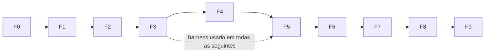

# 06 — Plano de Implementação

Regra: cada fase termina com todos os comandos de AGENTS.md §7 verdes + critérios de aceite + entrada em [PROGRESS.md](PROGRESS.md). Fases F1–F5 não tocam UI.

## F0 — Fundação do repositório
**Fazer**: workspace Cargo com crates vazios de 03 §2; `rust-toolchain.toml` (stable, ≥ 1.80); `deny.toml` com allowlist (MIT, Apache‑2.0, BSD‑2/3, Zlib, ISC, Unicode‑3.0, MPL‑2.0); CI GitHub Actions (fmt, clippy, test, deny, `cargo check -p av-core --target wasm32-unknown-unknown`) em Windows/Linux/macOS; `.gitignore` (target, bench-out, node_modules).
**Aceite**: os 5 comandos (fmt, clippy, test, `cargo deny check licenses`, check wasm32) verdes **localmente** e registrados em PROGRESS. CI remoto verde nos 3 SOs é exigido como **gate adiado**: obrigatório antes de concluir F6 (pré‑requisito de F7). Sem remoto, F1–F6 prosseguem com verificação local. (Decisão de direção técnica, 2026‑10‑28.)

## F1 — Raster, cor e parâmetros
**Fazer** (av-core): `raster.rs` (RgbaImage, validação de tamanho, limite 64 MP), `color/oklab.rs` (sRGB↔linear↔OKLab, LUT), `params.rs` (Params + presets JSON + `resolve_defaults(mode, detection)`), `error.rs`, `progress.rs` (Control, cancelamento). av-cli: decodificação via `image`, conversão 16‑bit→8‑bit, GIF 1º quadro.
**Testes**: OKLab ida‑e‑volta erro < 1e‑4 em 100k cores sRGB amostradas deterministicamente; valores de referência OKLab do artigo de Ottosson (branco, vermelho, etc.); serde round‑trip de Params; imagens 0×0 ⇒ `EmptyImage`.
**Aceite**: testes verdes; `antivector info img.png` imprime dimensões e has_alpha.

## F2 — Segmentação e grafo de fronteiras (núcleo topológico)
**Fazer**: 04 §3 (quantização), §5 (rotulagem), §6 (mesclagem — sem regra de detalhe fino ainda), §7 (grafo). Exportação SVG **poligonal** provisória (arestas como polilinhas de crack edges) em av-export/svg.rs. `--dump-stages` no CLI.
**Testes**: invariantes 04 §13.1, §13.3 (via resvg sem AA), cada Edge em 2 loops, proptest com imagens aleatórias 1..40 px e 2..6 cores (≥ 500 casos); xadrez 2×2 (junção diagonal); ilha dentro de ilha; imagem com toque diagonal.
**Aceite**: 0 frestas e área exata em todos os casos; SVG poligonal reproduz o raster quantizado pixel a pixel (render sem AA == LabelMap colorido).

## F3 — Harness de qualidade e baseline
**Fazer**: av-metrics (ΔE00 com casos de teste de Sharma et al. 2005, SSIM, gaps, stats); av-bench `gen`, `run`, `baseline vtracer`, `compare`, `perf`; montar corpus inicial (synthetic completo + ≥ 5 logos + ≥ 3 edge cases) com manifest e licenças. Calibrar detecção (04 §1) e executar experimento ADR‑007 (k‑means++ × median‑cut+refino × Wu); registrar resultado e fixar ADR‑007.
**Testes**: ΔE00 bate tabela de Sharma (erro < 1e‑4); SSIM(img,img)=1; harness roda fim‑a‑fim no CI com corpus mínimo.
**Aceite**: relatório HTML gerado; métricas de baseline vtracer e AntiVector‑poligonal salvas em `corpus/baselines/`.

## F4 — Ajuste de curvas
**Fazer**: 04 §8 (polígono ótimo, ajuste de vértices, cantos), §9 (Bézier, DP de nós, retas, frame), §10 montagem com loops reais. Paralelismo rayon por aresta.
**Testes**: círculo r=50 ⇒ ≤ 8 nós e Hausdorff ≤ 0,5 px; quadrado rotacionado 30° ⇒ exatamente 4 cantos, 4 Lines; estrela 5 pontas ⇒ 10 cantos; junções idênticas (13.4); determinismo 1 vs N threads (13.5); monotonicidade (13.6); 0 frestas mantido.
**Aceite**: synthetic: Hausdorff médio ≤ 0,5 px, corner recall ≥ 0,95; nós ≤ vtracer em ≥ 80% das synthetic com SSIM ≥ vtracer.

## F5 — Qualidade multicor (AA, detalhe, ruído)
**Fazer**: 04 §2 completo (alfa, upscale, bilateral), §4 (AA), regra de detalhe fino §6, snap de cores §3.6, modos/presets, modo empilhado com sobreposição (decidir default conforme ADR‑006/04 §10 e registrar ADR). Experimentos de denoise (04 §2.3) e pixel‑art (04 §8.6).
**Testes**: logo sintético com AA ⇒ nº de regiões = nº de formas do GT; JPEG q=60 sintético ⇒ nº de cores detectado = GT ±1; linha de 1 px preservada com detail=0,5.
**Aceite**: critérios 01 §6 de fidelidade e nós no corpus atual; avaliação visual cega gerada (pendente para o usuário).

## F6 — Exportação e CLI completos
**Fazer**: av-export SVG final (precisão configurável, agrupamento por cor, viewBox), PDF (`pdf-writer`), EPS (PostScript nível 2, DSC), DXF (R12, LWPOLYLINE/SPLINE → usar polilinhas com aproximação 0,1 px [DEFINITIVO por compatibilidade]), PNG (resvg). CLI completo (RF11): `vectorize`, `batch`, `info`, `--preset`, `--params file.json`, códigos de saída (0 ok, 2 parâmetros, 3 decodificação, 4 IO, 10 interno).
**Testes**: 07 §5 para cada formato; snapshots insta; batch de diretório com 1 arquivo corrompido continua os demais e retorna código 1 com resumo.
**Aceite**: todos os formatos válidos para o corpus inteiro.

## F7 — Sessão e app desktop básico
**Fazer**: av-session (StageCache com tabela 04 §11, cancelamento, jobs); app Tauri: scaffold `pnpm create tauri-app` (React‑TS), comandos IPC 03 §4, telas 05 §1, vistas lado a lado/slider/vetor/contorno, sliders com debounce, barra de progresso, cancelamento, exportação, estados 05 §4, pré‑visualização progressiva.
**Testes**: Rust — mudança só de smoothness não re‑executa quantização (contador de execuções por estágio); cancelar em < 200 ms após sinal. TS — vitest para store e componentes principais; teste e2e manual documentado (checklist em PROGRESS).
**Aceite**: fluxo rápido (01 §5.1) funciona nos 3 SOs via CI build; thread de UI sem bloqueio > 50 ms (medido com Performance API em imagem 4 MP).

## F8 — Edição
**Fazer**: EditOps (MergePalette, RecolorPalette, DeletePalette, LockColor, MergeRegion, RemoveRegion), undo/redo ≥ 100 (comando + snapshot leve por estágio), borracha de região, conta‑gotas, vista diferença, estatísticas, projeto `.avproj` (zip: imagem original + params.json + edits.json, versão de formato).
**Testes**: aplicar edição + undo ⇒ doc idêntico ao anterior (hash); 0 frestas após qualquer edição (proptest de sequências de edições); round‑trip de projeto.
**Aceite**: fluxo refinado (01 §5.2) completo.

## F9 — Otimização, robustez e release
**Fazer**: perf (meta RNF01–03), perfis com `cargo flamegraph`; fuzz de decodificação/pipeline (`cargo fuzz`, 1h local sem crash); i18n pt‑BR/en; acessibilidade 05 §5; instaladores Tauri (MSI, DMG, AppImage) ≤ 25 MB; corpus completo (07 §1); avaliação visual cega final.
**Aceite**: todos critérios 01 §6 e RNF medidos e registrados; zero panics no fuzz; instaladores gerados no CI.

## Definição de pronto (por tarefa)
Verificações pnpm passam a ser obrigatórias em F7, quando o app é criado. Correção
de direção técnica autorizada pelo usuário em 2026-10-28; F6 mantém os checks Rust
e o gate remoto Windows/Linux/macOS. Não antecipar scaffold de UI para F6.

Código + testes + docs atualizados (rustdoc em APIs públicas) + comandos AGENTS §7 verdes + sem regressão no harness (a partir de F3) + PROGRESS.md atualizado.

## Evolução e refatoração
- Refatorar somente com testes/harness verdes antes e depois; mudanças de algoritmo sempre com relatório `compare` anexado ao PROGRESS.
- Novos estágios entram atrás de flag em Params (`experimental.*`) até vencerem o A/B.
- Pós‑v1 (ordem sugerida): edição de nós Bézier, centerline, gradientes, versão web WASM, plugin ONNX de super‑resolução.
